# Eiryn

<div align="center">

**A modern, audiophile-grade offline music player built with Tauri v2, Vue 3, and Rust.**

[](https://tauri.app)
[](https://www.rust-lang.org)
[](https://vuejs.org)
[](https://tailwindcss.com)
[](#)
[](LICENSE)

</div>

---

## Overview

**Eiryn** is an offline music player designed for audiophiles, collectors, and music enthusiasts. Combining a high-performance **Rust** audio pipeline with a modern, glass-styled **Vue 3** interface, Eiryn delivers bit-perfect playback, advanced digital signal processing (DSP), real-time audio forensics, and instant library navigation across collections of 50,000+ tracks.

---

## Key Features

### 🎧 Audiophile-Grade Audio Pipeline

- **Bit-Perfect WASAPI Exclusive Mode**: Direct, unadulterated hardware stream bypassing the Windows audio mixer, with seamless fallback to low-latency Shared Mode.
- **Lookahead Peak Limiter**: Transparent -0.1 dBFS ceiling with a 16-sample lookahead buffer and 80ms release curve, eliminating inter-sample clipping and digital distortion during aggressive EQ boosts or positive ReplayGain.
- **Hardware DAC Pop Suppressor**: 20ms linear volume ramp-in upon stream initialization to prevent electrical popping on external USB DACs.
- **Ear Protection & Safe Volume**: Initial volume is capped to $\le 30\%$ when switching to an uncalibrated audio output device; playback automatically pauses if the active audio endpoint is disconnected.
- **EBU R128 & ReplayGain 2.0**: Integrated LUFS loudness normalization with smart clip-guard headroom.
- **Headphone Crossfeed**: Spatial acoustic simulation using **Meier** and **Chu Moy** algorithms to reduce listening fatigue on headphones.
- **Karaoke Center-Vocal Remover**: Real-time center-channel differential phase cancellation ($L - R$) paired with a 2nd-order Butterworth sub-bass retention filter ($< 150\text{ Hz}$).
- **10-Band Graphic & Parametric EQ**: Precise frequency shaping with AutoEq text preset importer.
- **Seamless Gapless & Crossfade**: Frame-accurate gapless transitions for live albums and classical movements, with configurable crossfade curves.
- **Smart Mix (Harmonic DJ Mixing)**: Automixes tracks using Camelot Wheel key compatibility and BPM tempo alignment curves.

---

### 🔍 Search & Library Performance

- **Lyric-Line Search (Tantivy BM25)**: Full-text indexing of timestamps and lyrics. Search remembered lyric phrases (e.g., *"we could be heroes"*) to locate tracks instantly, with matching lyric quotes highlighted directly in search results.
- **Precomputed Blake3 Album Entities**: Pre-aggregated database indexing eliminating client-side JavaScript grouping overhead, providing instantaneous loading of large discographies.
- **Balanced Shuffle Algorithm**: Deterministic SplitMix64 PRNG with a 48-hour recency delay, artist spacing windows, and album dispersion to prevent repetitive artist streaks.
- **LexoRank $O(1)$ Playlist Indexing**: Fractional string indexing (`0|00000a`, `0|00000am`) for instant single-row reorder updates without table locking.
- **Smart Playlists**: Dynamic rule builder supporting combinations of BPM, energy, year, play count, rating, bitrate, and genre.
- **CUE Sheet Virtual Tracks**: First-class support for single-file album rips with external or embedded `.cue` sheets.

---

### 🔬 Health & Audio Forensics

- **Whole-File FLAC Checksum Verification**: Decodes uncompressed PCM streams via Symphonia and validates MD5 hashes against the FLAC `STREAMINFO` block to catch bit rot and truncated downloads.
- **Fake 24-bit Lossless Detection**: Deep PCM bit distribution analysis flags 24-bit tracks that are actually zero-padded 16-bit upsamples.
- **Spectrogram & Cutoff Frequency Auditing**: FFT spectral analysis detects low-pass filter shelves to catch MP3 transcode upscales disguised as lossless FLAC.
- **Split Album & Dual-Script Artist Merging**: 1-click tools to reconcile split albums and unify multilingual artist metadata (e.g., Japanese Kanji vs. Romaji).
- **Recycle Bin Safe Delete**: Delete damaged or duplicate tracks directly to the system Recycle Bin.

---

### 💾 Portability & Data Safety

- **Single-File ZIP Backup & Restore**: Export playlists, smart rules, favorites, play history, custom EQ presets, and saved lyrics into a single `.eiryn-backup.zip` file.
- **Fuzzy Track Relinking**: Restoring backups automatically relinks tracks using absolute file paths or fallback `(title, artist, album)` matching when moving between different systems.

---

### ✨ Visuals & Desktop Integration

- **Glass Morphism Design**: Responsive backdrop blur, dynamic typography, and fluid transitions.
- **WebGL Living Artwork Canvas**: Ambient animated background canvases rendered on GPU, dynamically tuned to the color palette extracted from the playing album artwork.
- **Synced & Word-Level Karaoke Lyrics**: Real-time LRC scrolling with 4-second user-scroll suspension to prevent unwanted snap-back while reading.
- **System Media Transport Controls (SMTC)**: Native Windows 10/11 notification center flyout, lock screen controls, volume overlays, and keyboard media keys via `souvlaki`.
- **Floating Miniplayer**: Compact, borderless, always-on-top window for unobtrusive desktop listening.
- **Last.fm Scrobbling**: Background scrobble queue with offline caching and automatic backfill.
- **Browser Remote Control**: Built-in lightweight HTTP server allowing control of playback from any phone or tablet on the local network.

---

## Tech Stack

| Layer | Technologies |
| :--- | :--- |
| **Frontend** | [Vue 3](https://vuejs.org/) (Composition API, `<script setup>`), [TypeScript](https://www.typescriptlang.org/), [Tailwind CSS v4](https://tailwindcss.com/), [Pinia](https://pinia.vuejs.org/), [Radix Vue](https://www.radix-vue.com/), [Lucide Icons](https://lucide.dev/), [ECharts](https://echarts.apache.org/) |
| **Desktop Harness** | [Tauri v2](https://tauri.app/) (Multi-window, native IPC, DWM border styling) |
| **Audio Engine** | [Symphonia](https://github.com/pdeljanov/Symphonia) (Audio decoding), [CPAL](https://github.com/RustAudio/cpal) (WASAPI Exclusive/Shared streams), [Rubato](https://github.com/HEnquist/rubato) (Resampling), Custom 64-bit Lookahead Limiter, Butterworth DSP |
| **Database & Search**| [SQLite](https://www.sqlite.org/) via [SQLx](https://github.com/launchbadge/sqlx) (Async pool, WAL mode), [Tantivy](https://github.com/quickwit-oss/tantivy) (BM25 full-text engine) |
| **Metadata & Media** | [Lofty](https://github.com/Serial-ATA/lofty-rs) (ID3, Vorbis, FLAC tags), [Souvlaki](https://github.com/Sinova/souvlaki) (Windows SMTC), [Zip-rs](https://github.com/zip-rs/zip) |

---

## Audio Signal Path

```mermaid
flowchart LR
    A["Audio File\n(FLAC / WAV / MP3 / Opus / DSF)"] --> B["Symphonia Decoder"]
    B --> C["CUE Track Splitter"]
    C --> D["EBU R128 / ReplayGain Gain"]
    D --> E["10-Band / Parametric EQ"]
    E --> F["Headphone Crossfeed\n(Meier / Chu Moy)"]
    F --> G["Karaoke Filter\n(Phase Cancellation + Sub-Bass)"]
    G --> H["Lookahead Peak Limiter\n(-0.1 dBFS Ceiling)"]
    H --> I["DAC Ramp & Volume Scaler"]
    I --> J["Output Endpoint\n(WASAPI Exclusive / Shared)"]
```



---

## Getting Started

### Prerequisites

Ensure you have the following installed on your machine:

1. **Node.js** (v18.0 or later) and **pnpm** (recommended):
   ```bash
   corepack enable
   corepack prepare pnpm@latest --activate
   ```
2. **Rust & Cargo** (v1.77 or later):
   ```bash
   curl --proto '=https' --tlsv1.2 -sSf https://sh.rustup.rs | sh
   ```
3. **C++ Build Tools**:
   - On Windows: Visual Studio C++ Build Tools (with "Desktop development with C++" workload).

---

### Installation

Clone the repository and install frontend dependencies:

```bash
git clone https://github.com/raveendra47/Eiryn.git
cd Eiryn
pnpm install
```

---

### Development Mode

Run the complete development environment with live hot-reloading:

```bash
pnpm tauri dev
```

This starts the Vite development server on `http://localhost:1420` and launches the native Tauri desktop container.

---

### Building for Production

Compile an optimized production binary with an installer:

```bash
pnpm tauri build
```

The resulting executable and installer will be located in:
```text
src-tauri/target/release/
src-tauri/target/release/bundle/msi/
src-tauri/target/release/bundle/nsis/
```

---

## Available Scripts

| Command | Description |
| :--- | :--- |
| `pnpm dev` | Run Vite frontend development server only (browser mode) |
| `pnpm tauri dev` | Launch full native Tauri desktop application in development mode |
| `pnpm build` | Compile frontend assets to `/dist` |
| `pnpm tauri build` | Compile full native production desktop application |
| `pnpm test` | Run Vitest unit tests |
| `pnpm lint` | Run `vue-tsc` type check across all frontend components |
| `cargo test --manifest-path src-tauri/Cargo.toml` | Run all 56 backend Rust unit and integration tests |
| `cargo check --manifest-path src-tauri/Cargo.toml` | Check Rust backend compilation without full codegen |

---

## Keyboard Shortcuts

| Shortcut | Action |
| :--- | :--- |
| <kbd>Space</kbd> | Toggle Play / Pause |
| <kbd>Ctrl</kbd> + <kbd>→</kbd> | Next Track |
| <kbd>Ctrl</kbd> + <kbd>←</kbd> | Previous Track |
| <kbd>Ctrl</kbd> + <kbd>↑</kbd> | Increase Volume (+5%) |
| <kbd>Ctrl</kbd> + <kbd>↓</kbd> | Decrease Volume (-5%) |
| <kbd>Ctrl</kbd> + <kbd>K</kbd> | Open Search Bar |
| <kbd>Ctrl</kbd> + <kbd>L</kbd> | Toggle Lyrics Drawer |
| <kbd>Ctrl</kbd> + <kbd>Q</kbd> | Toggle Play Queue |
| <kbd>F11</kbd> | Toggle Fullscreen Player |

---

## License

This project is licensed under the [MIT License](LICENSE).
